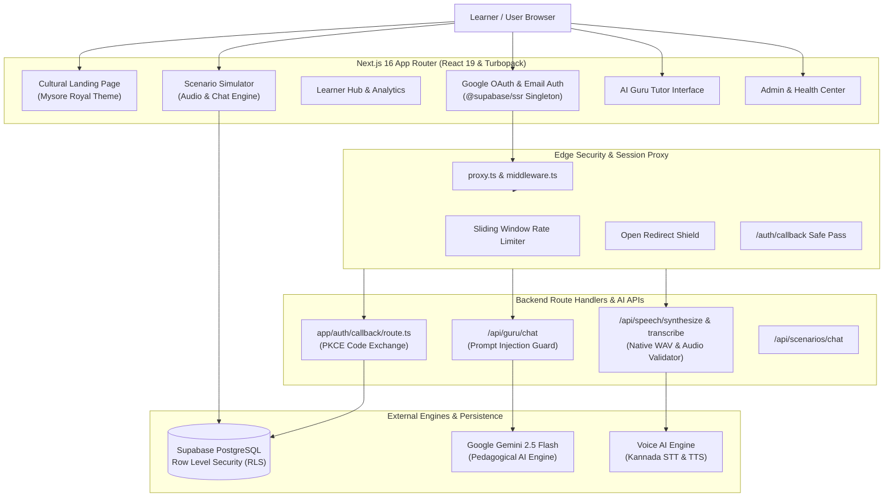

# 💛❤️ ಕನ್ನಡ ಕಲಿರಿ — Kannada Kaliri
### *Kannada for Everyone: The Intelligent, Cultural Bridge to Karnataka*

<div align="center">

[](https://kannada-kaliri.vercel.app/)
[](https://nextjs.org/)
[](https://react.dev/)
[](https://www.typescriptlang.org/)
[](https://supabase.com/)
[](https://tailwindcss.com/)

**[🌐 Experience the Live Application](https://kannada-kaliri.vercel.app/)** • **[📖 Curriculum](#-curriculum--pedagogical-architecture)** • **[🎙️ Voice & AI](#-ai-guru--voice-intelligence-engine)** • **[🏛️ Architecture](#-system-architecture)**

</div>

---

> ### 🌿 The Vision
> **Kannada for everyone: develop an interactive platform that helps non-Kannada speakers learn practical Kannada through everyday conversation situation vocabulary and guided practice.**
> 
> *Over 15 million people have moved to Bengaluru and Karnataka for technology, research, entrepreneurship, and education. While English works in tech parks, true belonging and warmth happen in everyday life — with auto drivers, darshini staff, local markets, neighbors, and coworkers. Kannada Kaliri transforms learning from rote grammar memorization into authentic, joyful cultural immersion.*

---

## 🌟 Why Kannada Kaliri Stands Apart

Unlike generic flashcard apps that teach isolated words or dry dictionary rules, **Kannada Kaliri (ಕನ್ನಡ ಕಲಿರಿ)** is purpose-built around **contextual fluency, speech confidence, and cultural empathy**:

```
 ┌─────────────────────────────────────────────────────────────────────────────┐
 │                     KANNADA KALIRI LEARNING EXPERIENCE                      │
 ├───────────────────┬───────────────────┬───────────────────┬─────────────────┤
 │  🎙️ Voice & Audio │  🎭 Real Scenarios│  🤖 AI Guru Tutor │  🏆 Mysore Glory│
 │   Speech AI with  │ Auto bargaining,  │  Conversational   │  Streaks, XP,   │
 │   waveform visual │ darshini coffee,  │  Gemini partner   │  badges, and    │
 │   & male/female   │ BMTC transit,     │  with live script │  real community │
 │   audio clips     │ and local markets │  & transliteration│  leaderboards   │
 └───────────────────┴───────────────────┴───────────────────┴─────────────────┘
```

---

## 🚀 Core Platform Features

### 1. 🎭 Interactive Real-World Scenario Simulator
Practice life in Karnataka with zero anxiety through rich interactive simulations:
- **🛺 Auto Rickshaw Negotiation:** Meter-rate discussions, destination requests (*"Indiranagar 100 Feet Road ge banni"*), and polite refusals.
- **☕ Darshini Tiffin & Filter Coffee Ordering:** Rapid breakfast interactions (*"Ondu Masala Dose, ondu Filter Coffee bisi-bisi kodi"*).
- **🚌 BMTC Bus Commuting:** Stage stops, ticket purchases, change exchange, and stop inquiries.
- **🥬 Local Vegetable Market (Santhe):** Fresh produce bargaining, weight inquiries, and payment via UPI.
- **💼 Tech Workplace Chit-Chat:** Friendly Kannada banter with colleagues during tea breaks.
- **🏥 Healthcare & Clinic Consultation:** Describing symptoms and understanding doctor advice clearly.

### 2. 🤖 AI Guru — 24/7 Conversational AI Companion
- Powered by high-speed generative AI with strict pedagogical guardrails.
- Explains grammatical structures in your native language (English, Hindi, Telugu, Tamil, or Malayalam).
- Provides trilingual representations for every response: **Kannada Script**, **English Transliteration**, and **Contextual Meaning**.
- Respects cultural etiquette: clarifies nuances between informal (*neenu*) and respectful formal (*neevu*).

### 3. 🎙️ High-Fidelity Voice AI & Audio Pronunciation
- **Dual Pronunciation Cadence:** Toggle between **Normal** spoken speed and **Slow** instructional speed to grasp subtle retroflex vowels (*ಳ vs ಲ*, *ಣ vs ನ*).
- **Dual Voice Modulation:** Experience authentic masculine and feminine native vocal inflections.
- **Speech-to-Text (STT) Analysis:** Evaluates spoken attempts directly in the browser with live visual waveform meters and phoneme accuracy feedback.

### 4. 📚 CEFR-Aligned A1/A2 Structured Curriculum
- **Module 01: The Sound of Kannada (ಧ್ವನಿ & ಅಕ್ಷರ):** Vowels (ಸ್ವರಗಳು), Consonants (ವ್ಯಂಜನಗಳು), and phonetics.
- **Module 02: Essential Survival Vocabulary (ಮೂಲ ಪದಕೋಶ):** Numbers, greetings, pronouns, and direction indicators (*ಇಲ್ಲಿ - illi*, *ಅಲ್ಲಿ - alli*).
- **Module 03: Sentence Building & Everyday Grammar (ವಾಕ್ಯ ರಚನೆ):** Tenses, postpositions, and question framing (*ಎಲ್ಲಿ, ಹೇಗೆ, ಎಷ್ಟು, ಯಾವಾಗ*).
- **Module 04: Cultural Nuances & Polite Forms (ಸಂಸ್ಕೃತಿ & ಗೌರವ):** Honorifics, festival greetings, and colloquial conversational shortcuts.

### 5. 🏆 Gamification & Cultural Achievements
- **Mysore Royal Aesthetic:** Inspired by the golden architecture of Mysore Palace (*ಅಂಬಾ ವಿಲಾಸ*) and the heritage of Karnataka.
- **Cultural Badges:** Unlock achievements like *ಕನ್ನಡ ಕಲಿ (Kannada Learner)*, *ಮೈಸೂರು ರತ್ನ (Mysore Jewel)*, and *ಕಾವೇರಿ ತೀರ (Cauvery Traveler)*.
- **Continuous Learning Streaks:** Daily challenges and community leaderboards to maintain consistency.

### 6. 🛡️ Executive Learning Analytics & Admin Dashboard
- Live learner telemetry, module completion rates, and aggregate engagement trends.
- Real-time AI and voice service health telemetry with sub-second error-budget tracking.
- Protected by server-enforced role-based access control (RBAC).

---

## 🏛️ System Architecture



---

## 🛠️ Technology Stack

| Layer | Technologies |
|---|---|
| **Framework** | [Next.js 16.4](https://nextjs.org/) (App Router, Turbopack, React 19 Server Components) |
| **Language** | Strict [TypeScript 5](https://www.typescriptlang.org/) |
| **Styling & Theme** | [Tailwind CSS v4](https://tailwindcss.com/) with Mysore Royal Gold (`#D5A64A`) & Deep Navy (`#101D36`) |
| **Typography** | `Cinzel` (Royal Serif), `Manrope` (Editorial Sans), and `Noto Sans Kannada` |
| **Authentication** | [Supabase SSR](https://supabase.com/docs/guides/auth/server-side/nextjs) with PKCE OAuth & Cookie Session Sync |
| **Database & Security** | [PostgreSQL](https://www.postgresql.org/) with Row Level Security (RLS) & hardened `search_path` |
| **Generative AI** | [Google Gemini 2.5](https://deepmind.google/technologies/gemini/) with multilingual instruction tuning |
| **Voice Intelligence** | Dual-speed Kannada Text-to-Speech (TTS) & Speech-to-Text (STT) with native Web Audio analyzers |
| **Hosting & CI/CD** | [Vercel](https://vercel.com/) with global edge routing |

---

## ⚡ Getting Started Locally

### 1. Clone the Repository
```bash
git clone https://github.com/varunrao246/kannada-kaliri.git
cd kannada-kaliri
```

### 2. Install Dependencies
```bash
npm install
```

### 3. Configure Environment Variables
Create a `.env.local` file in the root directory (refer to `.env.example`):

```env
# Supabase Authentication & PostgreSQL Database
NEXT_PUBLIC_SUPABASE_URL=https://your-project.supabase.co
NEXT_PUBLIC_SUPABASE_ANON_KEY=your-supabase-anon-key

# AI Tutor Service (Google Gemini)
AI_PROVIDER=google
AI_API_KEY=your-gemini-api-key

# Speech & Voice AI Service (Gnani Prisma / Audio Engine)
GNANI_API_KEY=your-gnani-api-key
GNANI_TOKEN=your-gnani-token
```

### 4. Run the Development Server
```bash
npm run dev
```
Open [http://localhost:3000](http://localhost:3000) in your browser to experience Kannada Kaliri locally.

### 5. Run Verification & Test Suites
```bash
# Full Next.js production build verification
npm run build

# ESLint inspection
npm run lint

# Security & RLS validation suite (35 automated tests)
npx tsx tests/e2e/test-m11-security.mjs

# E2E multilingual user journey suite (82 automated tests)
npx tsx tests/e2e/runner.ts
```

---

## 🔒 Security, Privacy & Reliability

- **PKCE Code Exchange:** Zero-credential exposure during Google OAuth with SSR cookie synchronization.
- **Row Level Security (RLS):** Every database row is isolated per authenticated learner; learners cannot inspect or tamper with peer data.
- **Prompt Injection Defense:** Strict regex and token boundary guards prevent jailbreaks and enforce Kannada learning context.
- **Zero Secret Leakage:** Error responses are sanitized before reaching clients; database internals and API keys are strictly redacted.
- **Safe Dynamic Redirects:** Hardened URL sanitizer prevents open redirect phishing attacks.

---

## 🤝 Community & Cultural Heritage

Kannada is one of India's classical languages, carrying an unbroken literary tradition spanning over 2,000 years — from the Halmidi inscriptions (450 CE) and Adikavi Pampa to the timeless Vachanas of Basavanna and 8 Jnanpith awards.

Kannada Kaliri honors this heritage by building bridges of mutual respect, welcoming every newcomer to feel at home in Karnataka:

<div align="center">

> *"ಸಿರಿಗನ್ನಡಂ ಗೆಲ್ಗೆ, ಸಿರಿಗನ್ನಡಂ ಬಾಳ್ಗೆ"*  
> *(May glorious Kannada triumph, may glorious Kannada prosper)*

**Crafted with pride in Mysuru, Karnataka 💛❤️**

[kannada-kaliri.vercel.app](https://kannada-kaliri.vercel.app/)

</div>
